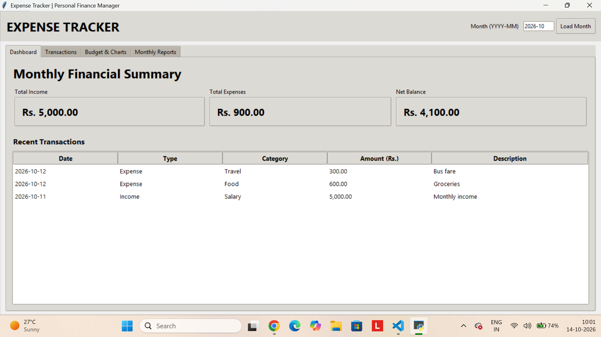

# 💰 Expense Tracker

A Python-based desktop application to manage daily expenses, track monthly budgets, and visualize spending through charts and reports.

## 🚀 Features
- Add and manage daily expenses
- Categorize expenses
- Set and track monthly budgets
- Visualize spending with charts
- Generate expense reports in PDF format
- Store data using SQLite database
- User-friendly graphical interface

## 🛠️ Technologies Used
- Python
- Tkinter
- SQLite
- Matplotlib
- ReportLab
- Git and GitHub

## ⚙️ Installation and Setup

1. Clone the repository:

   `git clone https://github.com/sanjayrock951-cmyk/Expense-Tracker.git`

2. Open the project folder:

   `cd Expense-Tracker`

3. Install the required libraries:

   `pip install -r requirements.txt`

4. Run the application:

   `python main.py`

## 📂 Project Structure

- `main.py` — Main application code
- `requirements.txt` — Required Python libraries
- `.gitignore` — Files excluded from version control
- `expenses.db` — Local database generated by the application

## 👨‍💻 Developer

Sanjay Kushwaha

B.Tech Information Technology Student

## 📸 Application Screenshot

